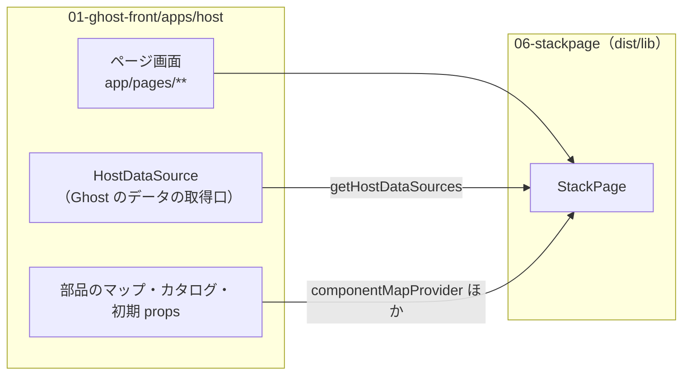

# StackPage

gridstack.js を土台にした、React のページビルダーのライブラリ。
フロントエンド（`01-ghost-front`）が `packages/stackpage` へのリンクとして使い、ホスト（`apps/host`）は `yarn build:lib` でビルドした `dist/lib` を読む。

## この文書の内容

| 節 | 内容 |
|---|---|
| [役割と位置](#役割と位置) | 何をするライブラリか、ホストとの分担 |
| [ホストとの約束](#ホストとの約束) | `StackPage` の props、HostDataSource、`__bindings`・`__schema` |
| [イベント](#イベント) | `__stackpage` の API、`__interactions` のルール、lifecycle イベント |
| [中の構成](#中の構成) | 主なフォルダとファイル |
| [開発の手順](#開発の手順) | 入れる・ライブラリのビルド・テスト・デモの起動 |
| [注意](#注意) | 壊しやすい所 |
| [詳しい文書](#詳しい文書) | このリポジトリの docs と、ホスト側の文書 |

## 役割と位置

- ドラッグ＆ドロップでページのレイアウトを組み、部品の props を編集し、データソースの結果を props に結びつける。
- 1 つの `<StackPage />` が `pageMode` で edit / preview / view の 3 つを受け持つ。
- 部品（React コンポーネント）とデータの取得口はホストが渡す。StackPage はレイアウト・props の編集・バインディング・イベントの実行だけをする。
- 保存するのはページの構成（レイアウト・ページの属性・データソースの設定・部品の props）だけで、データソースから取った値は保存しない。読み込むたびに取り直す。



## ホストとの約束

### `StackPage` の props

定義は `src/lib/components/stackpage.tsx` の `StackPageProps`。主なもの:

| prop | 役割 |
|---|---|
| `pageid`・`pageMode` | ページの id と、`"edit" \| "preview" \| "view"` |
| `onLoadLayout`・`onSaveLayout` | ページの読み込みと保存（ホストが API を呼ぶ） |
| `componentMapProvider` | 部品名 → React コンポーネント |
| `componentCatalogProvider` | 部品の一覧タブでの並べ方 |
| `componentPropsProvider` | 部品を置いたときの初期 props（`__schema` を含めてよい） |
| `getHostDataSources` | ホストのデータソース（`HostFunctionDataSource[]`）を返す |
| `urlQuery` | URL の query。データソースの `{{query.*}}` に使う |
| `i18n` | 画面の文言の翻訳（`StackI18n`） |

ホストから使える型と関数は `src/lib/index.ts` が書き出しているものだけ。CSS は `stackpage/styles`（`dist/lib/index.css`）で読む。

### HostDataSource

- 型は `src/lib/components/types.ts` の `HostFunctionDataSource`（`type: "host-function"`、`fetchData(params)`、`hostFunctionId`）。
- データソースの parameters には `{{query.*}}`・`{{state.*}}`・`{{params.*}}` を書ける。StackPage が先に値を解決し（`src/lib/utils/paramResolver.ts`）、`fetchData` には解決済みの値だけを渡す。ホストの関数はページの状態や URL を直接読まない。
- 保存したページを読み直したときは関数が無いので、`hostFunctionId` でホストの関数を探して呼ぶ。
- `{{state.*}}` が変わると、解決後の値が変わったときだけ 350ms 待って取り直す（`src/lib/components/useReactiveDataSources.ts`）。

### 部品の props の予約キー

| キー | 内容 |
|---|---|
| `__schema` | Properties タブ（RJSF）で編集する props の JSON Schema |
| `__schemaOptions` | Properties タブで `__schema` と一緒に使う設定 |
| `__bindings` | データソースの結果を props のどこに入れるか（`sourceId`・`path`・`selector`） |
| `__ignoredMappings` | 自動の対応づけから外した項目 |
| `__interactions` | イベントのルール（次の節） |

保存の前に、`__bindings` で入った値は props から外す（`src/lib/utils/pagePersistence.ts` の `stripRuntimeBoundValuesFromLayout` / `stripRuntimeBoundValuesFromProps`）。

部品とデータソースの書き方の決まり（`__schema` の書き方、`keyword` の名前など）はホスト側の
[platform/stackpage.md](https://github.com/aidabo/jibunsee-react/blob/main/docs/platform/stackpage.md) にある。

## イベント

部品は props で `__stackpage`（`StackPageRuntimeApi`、`src/lib/utils/componentCommunication.ts`）を受け取る。

- `emit`・`emitWithAck`（返事を待つ）・`subscribe`・`unsubscribe`
- `setState`・`getState`・`setPageState`・`getPageState`（ページの共有の状態）

部品が出したイベントは、`__interactions` のルール（`InteractionRule`）と照らして実行する。動作は
`set-prop`・`set-shared-state`・`emit-event`・`emit-request` の 4 つ。ルールの実行はランタイムが行い、部品ごとの処理は書かない。

lifecycle イベントは `widget:init`・`widget:load`・`widget:unmount` を部品の描画（`src/lib/gridstack/grid-stack-widget-render.tsx`）が出す。
`page:init`・`page:load`・`page:ready` は型と `createStackPagePageLifecycleTracker` があるだけで、ライブラリの中からは出していない。

詳しくは [docs/event-system-spec.md](docs/event-system-spec.md) と、ホスト側の
[platform/stackpage-event-guide.md](https://github.com/aidabo/jibunsee-react/blob/main/docs/platform/stackpage-event-guide.md)。

## 中の構成

| 場所 | 内容 |
|---|---|
| `src/lib/` | ライブラリ本体。入口は `src/lib/index.ts` |
| `src/lib/components/` | `stackpage.tsx`・`StackPageProvider.tsx`、編集のタブとダイアログ、`DataSourceService.ts`・`useDataBinding.ts` |
| `src/lib/gridstack/` | gridstack の描画（`grid-stack-render.tsx`・`grid-stack-widget-render.tsx`） |
| `src/lib/utils/` | バインディング（`bindingEngine.ts`）・イベント（`componentCommunication.ts`）・パラメータ・保存の処理 |
| `src/demo/` | デモのアプリと見本の部品 |
| `data/db.json` | デモのページのデータ（json-server が読む） |
| `tests/` | ランタイムのテスト（`vite-node` で 1 ファイルずつ動かす） |
| `docs/` | 仕様と計画の文書 |

ビルドの出力は `dist/lib`（ライブラリ）と `dist/demo`（デモ）。`dist/` は git に入っていない。

## 開発の手順

```bash
cd ~/work/legacy/06-stackpage
yarn install
yarn build:lib       # tsc の型検査のあと dist/lib を作る。ホストはこれを読む
yarn test:runtime    # ランタイムのテストをまとめて動かす
```

- 1 つだけ動かすときは `yarn test:binding`・`yarn test:communication`・`yarn test:page-state` など（`package.json` の `test:*`）。
  `tests/` には `test:runtime` に入っていないファイル（`page-persistence`・`runtime-api`・`schema-formats`・`schema-uri`）もあり、
  それらは `npx vite-node tests/<file>` で動かす。
- デモ: `yarn jsonserver`（`data/db.json` をポート 3500 で出す）と `yarn dev`（Vite）を別々に起動する。
  Vite は `/api` を `http://localhost:3500` へ中継する（`vite.config.ts`）。
- `yarn build` は `build:lib` と `build:demo` の両方をする。

ホストと合わせて動かす手順は
[06-business-libs-estate.md](https://github.com/aidabo/jibunsee-react/blob/main/docs/development/06-business-libs-estate.md) と
[04-frontend.md](https://github.com/aidabo/jibunsee-react/blob/main/docs/development/04-frontend.md)。

## 注意

- ホストは `dist/lib` を読む。`src` を直したら `yarn build:lib` し直さないと、ホストには反映されない。
- `src/lib/index.ts` の書き出しや `StackPageProps` を変えると、ホストの型検査やビルドが壊れる。変えたらホスト側も確かめる。
- 保存済みのページの JSON（`__bindings`・`__interactions`・データソースの設定）はホストの DB に残っている。形を変えるときは古いページも読めるようにする。
- デバッグの log は `localStorage.setItem("stackpage:debug", "1")` で出る（バインディングだけなら `stackpage:debug:binding`）。

## 詳しい文書

- [docs/README.md](docs/README.md) — このリポジトリの docs の入口
- [docs/event-system-spec.md](docs/event-system-spec.md) — イベントとルールの仕様
- [docs/lifecycle-events-and-stackpage-api-plan.md](docs/lifecycle-events-and-stackpage-api-plan.md) — lifecycle イベントの計画
- [docs/page-builder-workflow-and-ai-plan.md](docs/page-builder-workflow-and-ai-plan.md) — ページの組み方と、AI の補助の計画
- ホスト側（jibunsee-react）:
  [platform/stackpage.md](https://github.com/aidabo/jibunsee-react/blob/main/docs/platform/stackpage.md)・
  [01-workspace.md](https://github.com/aidabo/jibunsee-react/blob/main/docs/development/01-workspace.md)

ライセンスは `package.json` のとおり MIT。
